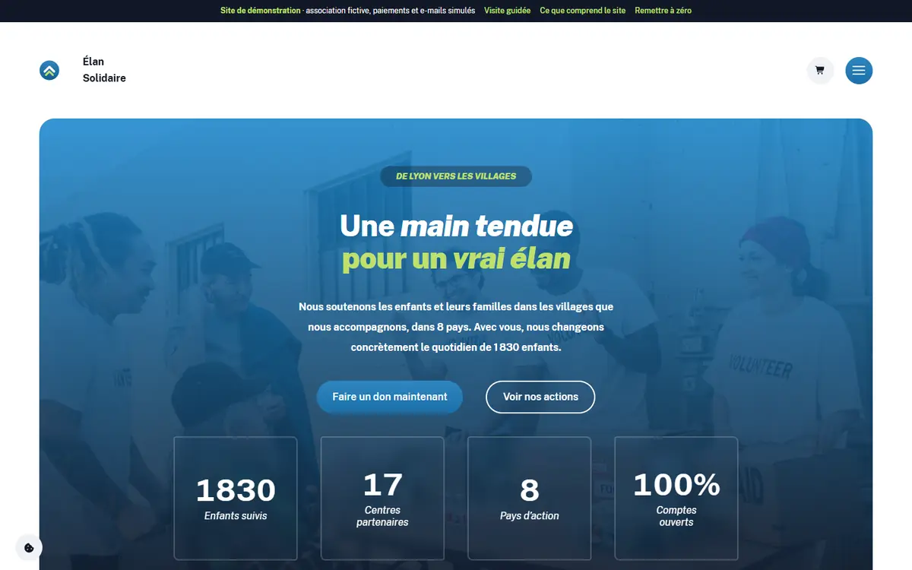
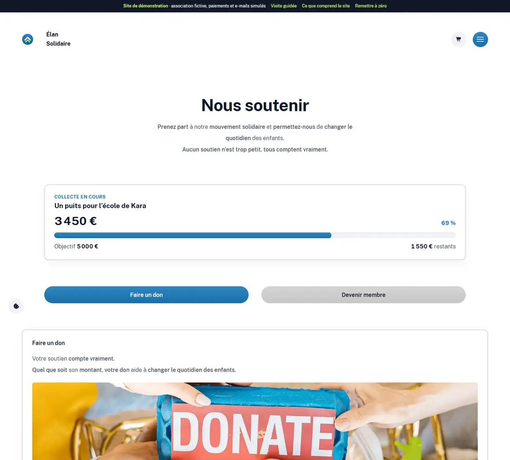
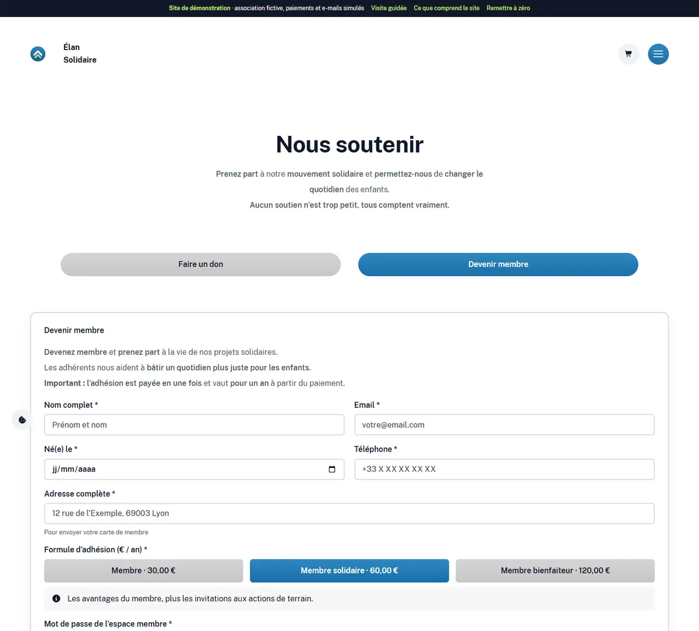
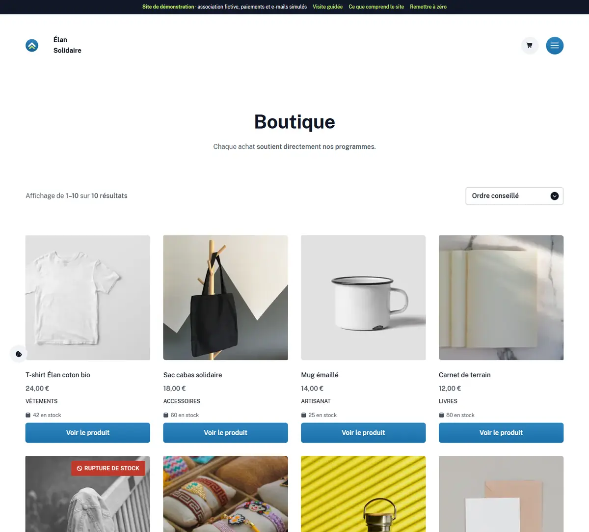
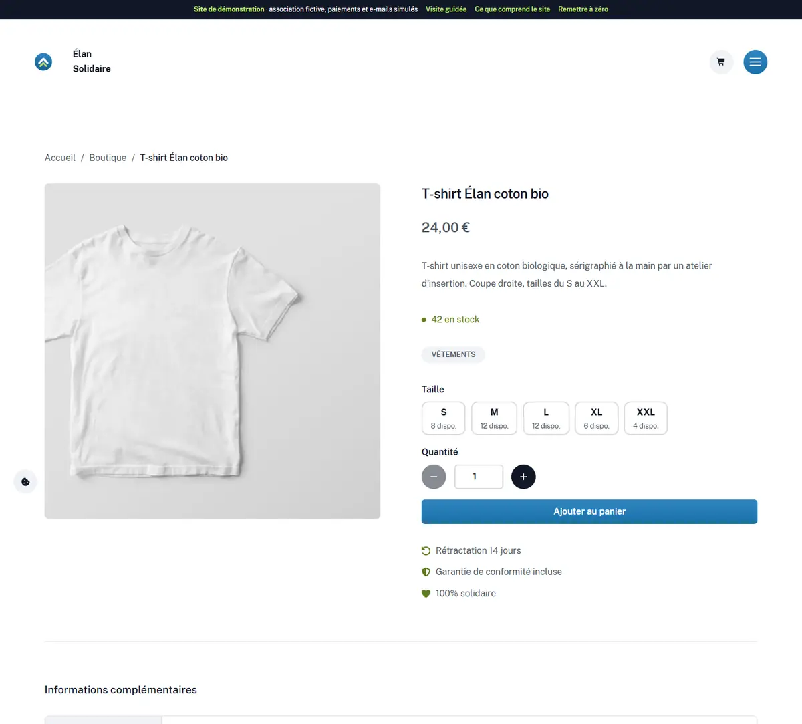
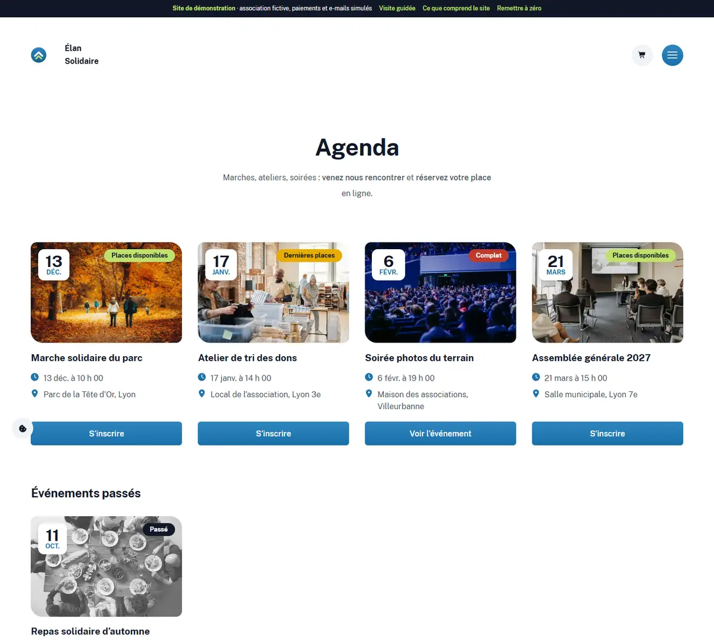
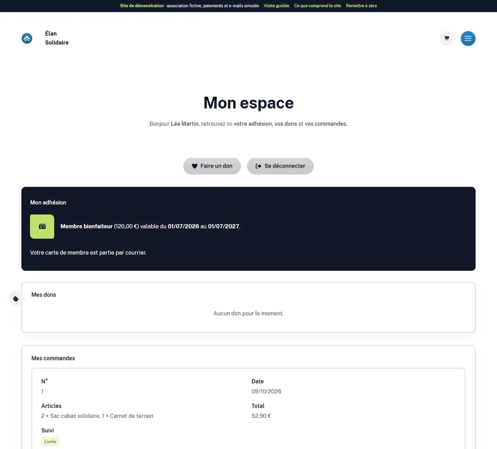
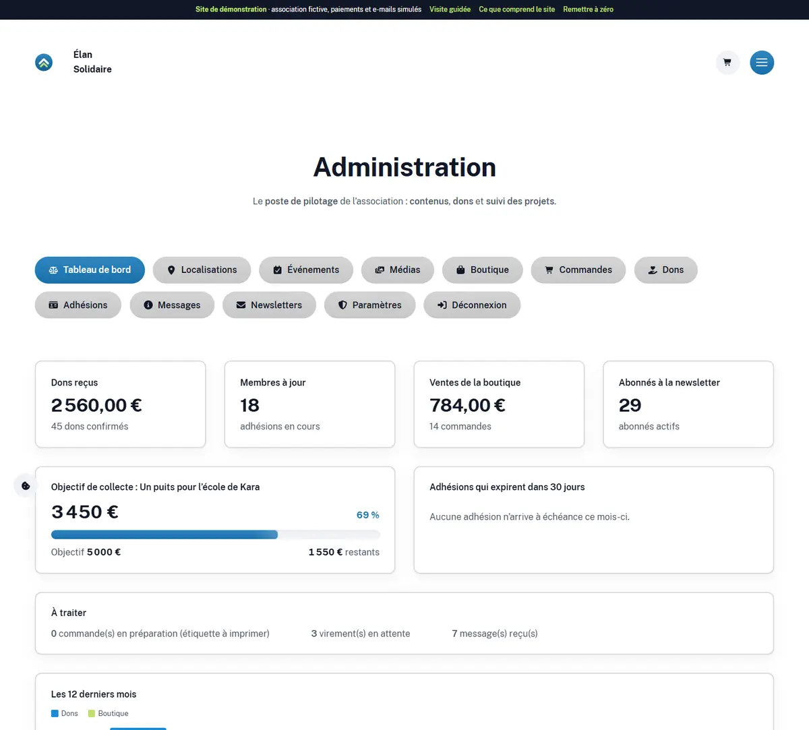
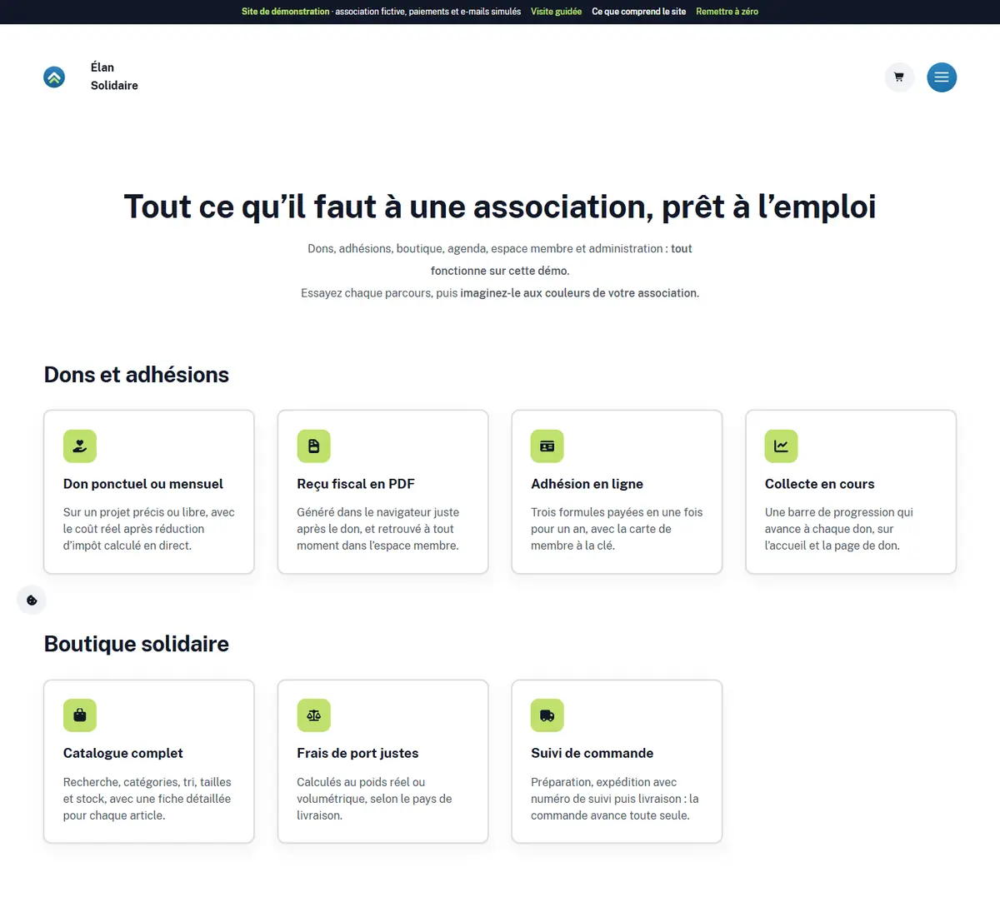
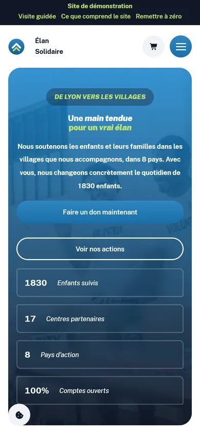

<p align="center">
  <a href="https://elan-solidaire.djason-chery.dev" title="Ouvrir la démo en ligne d'Élan Solidaire"></a>
</p>

<p align="center">
  <a href="https://elan-solidaire.djason-chery.dev" title="Ouvrir la démo en ligne"></a>
  
  
  
  
  
  <a href="LICENSE" title="Lire la licence"></a>
</p>

<p align="center">
  <a href="https://elan-solidaire.djason-chery.dev" title="Ouvrir la démo en ligne"><b>VOIR LA DÉMO</b></a> &nbsp;&nbsp;·&nbsp;&nbsp;
  <a href="#ce-que-montre-la-démo" title="Aller aux fonctionnalités"><b>FONCTIONNALITÉS</b></a> &nbsp;&nbsp;·&nbsp;&nbsp;
  <a href="docs/fr/architecture.md" title="Lire la documentation en français"><b>DOCUMENTATION</b></a> &nbsp;&nbsp;·&nbsp;&nbsp;
  <a href="README.md" title="Read this page in English"><b>ENGLISH</b></a>
</p>

# Élan Solidaire

[English](README.md "Read this page in English") · **Français**

Site de démonstration d'**Élan Solidaire**, une association humanitaire **fictive** basée à Lyon : accueil avec carte
interactive, dons ponctuels ou mensuels, adhésions, boutique solidaire avec panier, agenda avec inscription, formulaire
de contact, espace membre et administration complète.

C'est un projet de portfolio de [Djason CHERY](https://djason-chery.dev "Site de Djason CHERY") : la refonte, en
Next.js et React, d'un vrai site réalisé auparavant, dont toute trace du vrai client a été remplacée par du contenu
inventé. **Rien n'est réel** : l'association, les personnes, les adresses, les produits et les coordonnées bancaires
sont inventés, les paiements et les e-mails sont simulés.

**Démo en ligne : [elan-solidaire.djason-chery.dev](https://elan-solidaire.djason-chery.dev "Ouvrir la démo en ligne")**

## Ce que montre la démo

| Partie | Fonctionnalités |
| --- | --- |
| Accueil | Bandeau avec chiffres clés, collecte en cours, mission, carrousels, carte des actions (Leaflet, chargée seulement après accord), programmes, newsletter, galerie photo, questions |
| Nous soutenir | Don à un projet (montant proposé ou libre), ponctuel ou mensuel, coût après la réduction d'impôt de 66 % affiché en direct, formules d'adhésion, paiement par carte ou PayPal (simulés) ou par virement |
| Collecte | Barre de progression d'une collecte en cours (accueil, page don, tableau de bord), mise à jour à chaque don de démo |
| Reçu fiscal | Reçu fiscal fictif en PDF généré dans le navigateur, aussi dans l'espace membre |
| Boutique | Catalogue avec recherche, catégories, tri et pages, fiches produit avec tailles et stock par taille, panier, frais de port au poids facturé, commande |
| Commandes | Payée tout de suite, puis « En préparation », « Expédiée » (numéro de suivi fictif, page `/suivi/`) et « Livrée », une minute d'écart sur la démo ; un toast à chaque étape ; l'admin peut annuler ou rembourser |
| Agenda | Événements (`/evenements/`) en cartes avec bloc date et statut (places disponibles, dernières places, complet, passé), événements passés à part ; inscription en ligne, visible dans l'espace membre, gérés dans l'admin |
| Comptes | Connexion, comptes de démo en un clic, mot de passe oublié avec lien valable une heure et une seule fois, espace membre (adhésion, dons, commandes, inscriptions) |
| Administration | Tableau de bord (dons par mois, objectif de collecte, adhésions qui expirent sous 30 jours, à traiter), événements, dons (export CSV, reçus), membres, commandes, messages, éditeurs des produits / lieux de la carte / photos (images compressées en WebP dans le navigateur), newsletter, réglages |
| Ce que comprend ce site | Page `/fonctionnalites/` (bannière de démo) : toutes les fonctions par partie, ce qui est simulé et ce qui deviendrait réel |
| Outils de la démo | Bannière « Site de démonstration » avec visite guidée (6 étapes, clavier, jusqu'à 320 px), « Ce que comprend le site » et « Remettre à zéro » avec confirmation |

<table>
  <tr>
    <th width="50%">Faire un don</th>
    <th width="50%">Devenir membre</th>
  </tr>
  <tr>
    <td width="50%"></td>
    <td width="50%"></td>
  </tr>
  <tr>
    <th width="50%">Boutique</th>
    <th width="50%">Fiche produit</th>
  </tr>
  <tr>
    <td width="50%"></td>
    <td width="50%"></td>
  </tr>
  <tr>
    <th width="50%">Agenda</th>
    <th width="50%">Espace membre</th>
  </tr>
  <tr>
    <td width="50%"></td>
    <td width="50%"></td>
  </tr>
  <tr>
    <th width="50%">Administration</th>
    <th width="50%">Ce que comprend ce site</th>
  </tr>
  <tr>
    <td width="50%"></td>
    <td width="50%"></td>
  </tr>
</table>

<table>
  <tr>
    <th width="50%">Téléphone</th>
    <th width="50%">Menu</th>
  </tr>
  <tr>
    <td width="50%" align="center"></td>
    <td width="50%" align="center"></td>
  </tr>
</table>

### Ce qui est simulé

Il n'y a ni serveur ni base de données. `utils/api.ts` garde l'interface d'un client d'API REST et `utils/demo/`
répond à chaque requête dans le navigateur, avec les mêmes routes, les mêmes codes HTTP et le même JSON qu'une vraie
API (validation, contrôle des droits, délai simulé). Ce que fait le visiteur reste dans le `localStorage` (clé
`elan-solidaire-demo`), relu et vérifié à chaque ouverture. Les mots de passe sont gardés sous forme d'empreinte
SHA-256 salée. Les e-mails ne partent jamais : un aperçu est montré. « Remettre à zéro », dans la bannière, remet les
données de départ. Détails et branchement d'une vraie API :
[docs/fr/api-de-demo.md](docs/fr/api-de-demo.md "API de démo").

### Comptes de démo

Aussi en boutons sur la page de connexion.

| Rôle | E-mail | Mot de passe |
| --- | --- | --- |
| Admin | `admin@elan-solidaire.example` | `Demo-Admin-2026` |
| Membre | `membre@elan-solidaire.example` | `Demo-Membre-2026` |

Cartes de test du paiement simulé : `4242 4242 4242 4242` est acceptée, `4000 0000 0000 0002` est refusée.
Aucun script Stripe ou PayPal n'est chargé et aucun numéro de carte ne sort de la fenêtre de paiement.

## Stack

- [Next.js 16](https://nextjs.org "Next.js") (Pages Router) et React 19, en **TypeScript** strict, exporté en **site
  statique** (`output: 'export'`) : ni serveur, ni base de données
- [Zustand](https://zustand.docs.pmnd.rs "Zustand") pour les stores (session, panier, cache de l'admin, fenêtres,
  visite guidée, collecte) et leurs actions dans `stores/actions/`
- [Leaflet](https://leafletjs.com "Leaflet") pour la carte, téléchargé seulement quand le visiteur l'accepte
- CSS simple avec les variables du design d'origine (bleu, vert anis, bleu nuit), police Public Sans hébergée avec le
  site, icônes SVG intégrées
- Structure de **[DC Scaffold](https://tools.djason-chery.dev/fr/scaffold/ "Découvrir DC Scaffold")**, le générateur de
  projets de l'auteur (un fichier par page, vues dans `components/views/`, stores et leurs actions, même format JSON
  que les API générées)

## Lancer le site

Il faut Node.js 20 ou plus récent.

```bash
cd frontend
npm install
npm run dev        # http://localhost:3000
```

Sous Windows, `start.bat` puis `D` fait la même chose (et installe ce qui manque). macOS et Linux : `./start.sh`.

Les réglages sont dans `frontend/.env` (développement) et `frontend/.env.production` (build) : copier
`frontend/.env.example`. Ils contiennent seulement le nom et l'adresse du site ; aucun secret n'est nécessaire.

## Scripts et contrôles

À lancer dans `frontend/`. Tous doivent finir sans erreur ni avertissement.

| Commande | Rôle |
| --- | --- |
| `npm run dev` | Site de développement sur http://localhost:3000 |
| `npm run typecheck` | TypeScript (`tsc --noEmit`, mode strict) : zéro erreur |
| `npm run lint` | ESLint : zéro erreur, zéro avertissement |
| `npm run build` | Site statique dans `frontend/out/`, puis `sitemap.xml`, `robots.txt` et les empreintes de la CSP dans `_headers` (`scripts/sitemap.mjs`, `scripts/csp.mjs`) |
| `npm run test:ui` | Contrôles de l'interface avec Playwright sur le site construit servi en local, à 320, 375, 768, 1024 et 1440 px (voir plus bas) |

`npm run test:ui` vérifie le survol de chaque élément interactif, l'écart entre les blocs de chaque formulaire
(`--form-gap`, 1 px au plus), le padding des cartes, l'alignement des cases et boutons radio, `aria-current="page"` sur
chaque lien de navigation vers la page courante, et les retours (erreurs et réussites en toasts, jamais sous les
champs). Exemple : `BASE=http://localhost:3100 npm run test:ui`.

## Dossiers

```text
frontend/
├── pages/                 un fichier par page : il pose son SEO et affiche sa vue
├── components/
│   ├── layout/            AppShell (chargement, en-tête, pied de page, fenêtres), Header, Footer
│   ├── ui/                briques réutilisables : BaseButton, CircleButton, FormField, Modal, DataList, Icon, SiteImage...
│   └── views/             le contenu de chaque page (Home, Support, Shop, Product, Cart, Events, Admin...)
├── composables/           hooks : useForm, useApiData, usePayment, useReveal...
├── middleware/            guards.ts : pages privées (/admin, /espace-membre)
├── stores/                stores Zustand (auth, cart, support, admin, ui, notifications, demo, tour, fundraiser, userPreferences) ; leurs actions dans stores/actions/
├── utils/
│   ├── api.ts             client de l'API : get, post, put, delete, download
│   ├── demo/              l'API de démo : routeur, gestionnaires, données de départ (seed/), stockage localStorage
│   ├── content/           textes et données de l'association fictive
│   ├── types.ts           types partagés (Product, CartItem, Order, Donation, Membership, Event, Place, Toast...)
│   ├── validation.ts      règles de chaque formulaire, utilisées par les formulaires et par l'API de démo
│   ├── shipping.ts        frais de port au poids facturé
│   └── seo.ts             titre, description, Open Graph et JSON-LD de chaque page
├── assets/css/            main.css importe : utils/ (polices, variables), base/, components/ (un fichier par composant partagé), views/
├── scripts/               sitemap.mjs, csp.mjs (après le build)
├── tests/                 ui-checks.mjs et ses sondes : contrôles automatiques de l'interface (npm run test:ui)
└── public/                polices, photos (WebP), logo, favicons, _headers, _redirects, .htaccess
scripts/                   outils de start.bat / start.sh
docs/                      documentation détaillée (fr, en) et captures
```

Plus de détails : [docs/fr/architecture.md](docs/fr/architecture.md "Architecture").

## Règles de mise en page (conventions du site)

- **TypeScript strict** partout (`strict`, `noUncheckedIndexedAccess`, alias `@/`), sans `any` ni `@ts-ignore` (une
  seule exception commentée : le corps JSON des requêtes de la démo, vérifié par `utils/validation.ts`).
- **Tailles et espacements par classes** : les classes `text-*` (`text-small`, `text-normal`, `text-large`...) donnent
  la taille de chaque texte, y compris des champs et de leurs placeholders (16 px minimum sur téléphone) ;
  l'espacement passe par les classes `gap-*`, `mt-*` et `mb-*`.
- **Composants de base** : boutons et champs passent par `BaseButton`, `CircleButton` et `FormField`, jamais faits à
  la main.
- **Retours en toasts** : erreurs et réussites dans une notification, jamais de texte d'erreur sous les champs.
- **Survol et appui** : seulement à la souris, dans `@media (hover: hover) and (pointer: fine)`.
- **Liens** : le lien vers la page courante porte `aria-current="page"` ; jamais de lien entre parenthèses.
- **Un seul écran de chargement** léger (les quatre barres bleues du design), à l'ouverture et à chaque changement de
  page, sans bloquer les clics.
- **Accessibilité** : jusqu'à 320 px de large et de haut, tableaux transformés en cartes sur téléphone, clavier
  partout, focus visible, champs avec libellé, contrastes AA, chaque lien a un `title`, chaque image un `alt` et un
  `title`.

## Choix techniques

- **Une API de démo plutôt qu'un serveur** : remplacer `utils/demo/` par une vraie API suffit, les vues et les stores
  ne changent pas.
- **Pages statiques avec leur vrai contenu** : les pages publiques sont construites avec les données de départ
  (`getStaticProps`), leur HTML est donc complet pour les moteurs de recherche, puis mis à jour avec les données du
  navigateur du visiteur.
- **Sécurité côté front** : aucune injection de HTML (pas de `dangerouslySetInnerHTML` sur une donnée, bulles de la
  carte construites avec `textContent`), données relues du `localStorage` vérifiées, mots de passe de démo hachés,
  jetons de paiement et de réinitialisation tirés au hasard, mêmes règles de validation dans les formulaires et dans
  l'API de démo, prix toujours recalculés depuis le catalogue, export CSV protégé contre l'injection de formules, liens
  externes en `rel="noopener noreferrer"`, CSP stricte.
- **Vitesse** : polices et images du premier écran préchargées, carte et sa bibliothèque chargées seulement après
  accord, icônes en SVG (pas de police d'icônes), photos en WebP en cinq largeurs (320 à 1920 px) servies avec
  `srcset` et `sizes` par un chargeur d'images maison (`utils/imageLoader.ts`).

### Produits et livraison

Chaque produit a un **poids en grammes**, des **dimensions** longueur × largeur × hauteur en cm et, pour les vêtements,
des **tailles** (S, M, L, XL...) avec leur propre stock ; les autres produits sont en taille unique. Le formulaire de
l'admin les demande avec leur unité et les vérifie (poids de 1 à 30 000 g, chaque côté de 0,1 à 200 cm, tailles écrites
`S:8, M:12`), la page produit les affiche avec un choix de taille, et le panier garde une ligne par produit **et** par taille.

La livraison se calcule sur le **poids facturé** du colis : le plus grand des deux

- le **poids réel** : somme des poids des articles ;
- le **poids volumétrique** : somme des volumes (L × l × H en cm³) divisée par **5 000**, le diviseur habituel des
  transporteurs (un colis léger mais encombrant coûte comme un colis plus lourd).

Le poids facturé tombe dans une **tranche de poids**, et chaque zone a un prix par tranche (`utils/shipping.ts`) :

| Poids facturé | France | Europe proche (BE, LU, DE, ES, IT) | Suisse, Canada |
| --- | --- | --- | --- |
| jusqu'à 0,5 kg | 4,90 € | 9,90 € | 14,90 € |
| jusqu'à 1 kg | 6,90 € | 12,90 € | 19,90 € |
| jusqu'à 2 kg | 8,50 € | 15,90 € | 26,90 € |
| jusqu'à 5 kg | 12,90 € | 22,90 € | 39,90 € |
| plus de 5 kg | 19,90 € | 32,90 € | 59,90 € |

La livraison est offerte en France dès 60 € d'articles. Le même calcul tourne dans le panier et dans l'API de démo, qui
recalcule les prix depuis le catalogue et vérifie le stock de chaque taille.

### Adresses des pages

Toutes les adresses visibles sont en français avec des slugs lisibles (le code reste en anglais). Les anciennes
adresses anglaises renvoient vers les nouvelles en 301 grâce à `frontend/public/_redirects` (Cloudflare Pages).

| Page | Adresse |
| --- | --- |
| Accueil (mission, carte, actions, photos, questions en sections) | `/` |
| Don / adhésion | `/don/`, `/adhesion/` |
| Coordonnées du virement | `/virement/` |
| Boutique / produit | `/boutique/`, `/boutique/produit/<slug>/` (produit ajouté dans l'admin : `/boutique/produit/apercu/?produit=<slug>`) |
| Panier et paiement | `/panier/` |
| Suivi de colis | `/suivi/?colis=<numéro>` |
| Contact | `/contact/` |
| Connexion / mot de passe oublié | `/connexion/`, `/mot-de-passe-oublie/` |
| Agenda / événement | `/evenements/`, `/evenements/<slug>/` |
| Ce que comprend le site | `/fonctionnalites/` |
| Espace membre | `/espace-membre/` |
| Administration | `/admin/`, `/admin/produits/`, `/admin/lieux/`, `/admin/evenements/`, `/admin/medias/`, `/admin/commandes/`, `/admin/dons/`, `/admin/adhesions/`, `/admin/messages/`, `/admin/newsletters/`, `/admin/reglages/` |
| Pages légales | `/mentions-legales/`, `/confidentialite/`, `/cookies/`, `/cgv/` |

Les slugs viennent de `frontend/utils/slugify.ts` (minuscules, sans accent, tirets) ; un produit créé dans l'admin
reçoit un slug unique (`uniqueSlug`) qui ne change pas s'il est renommé. `/admin` et `/espace-membre` sont en
`noindex` et exclus du `sitemap.xml` et du `robots.txt`.

## Mettre en ligne

La démo est en ligne sur **Cloudflare Pages**, projet `elan-solidaire`, à l'adresse
**[elan-solidaire.djason-chery.dev](https://elan-solidaire.djason-chery.dev "Ouvrir la démo en ligne")** (un
enregistrement CNAME chez Infomaniak pointe vers `elan-solidaire.pages.dev`). Mise en ligne en une commande :

```bash
cd frontend && npm run build && npx wrangler pages deploy out --project-name elan-solidaire --branch master
```

Pour un autre projet Cloudflare Pages relié à un dépôt Git, les réglages sont :

| Réglage | Valeur |
| --- | --- |
| Root directory | `frontend` |
| Build command | `npm run build` |
| Build output directory | `out` |
| Variables d'environnement | `NEXT_PUBLIC_SITE_NAME=Élan Solidaire`, `NEXT_PUBLIC_SITE_URL=https://<votre-projet>.pages.dev` |

`frontend/public/_headers` pose les en-têtes de sécurité (Content Security Policy stricte, `X-Content-Type-Options`,
`Referrer-Policy`, `Permissions-Policy`, `frame-ancestors`) et les règles de cache chez Cloudflare.
`frontend/public/.htaccess` fait la même chose chez un hébergeur Apache. Étapes complètes :
[docs/fr/mise-en-ligne.md](docs/fr/mise-en-ligne.md "Mise en ligne").

## Documentation

| Sujet | English | Français |
| --- | --- | --- |
| Architecture | [architecture.md](docs/en/architecture.md "Architecture (English)") | [architecture.md](docs/fr/architecture.md "Architecture") |
| API de démo | [demo-api.md](docs/en/demo-api.md "Demo API (English)") | [api-de-demo.md](docs/fr/api-de-demo.md "API de démo") |
| Mise en ligne | [deployment.md](docs/en/deployment.md "Deployment (English)") | [mise-en-ligne.md](docs/fr/mise-en-ligne.md "Mise en ligne") |
| Crédits | [credits.md](docs/en/credits.md "Credits (English)") | [credits.md](docs/fr/credits.md "Crédits") |

## Licence

Code visible à titre de démonstration, **tous droits réservés** : aucune réutilisation sans accord écrit, voir [LICENSE](LICENSE "Licence") (licence d'utilisation sur demande : [djason-chery.dev](https://djason-chery.dev "Site de Djason CHERY")). La police Public Sans est sous SIL Open Font License 1.1, les icônes viennent de Font
Awesome Free (CC BY 4.0), les photos de Pexels (licence Pexels, voir les [crédits](docs/fr/credits.md "Crédits")).

## Crédits

- Photos : 33 photos libres de [Pexels](https://www.pexels.com "Pexels") (licence Pexels, 25 photographes),
  redimensionnées et converties en WebP ; la liste complète est dans les mentions légales du site et dans
  [docs/fr/credits.md](docs/fr/credits.md "Crédits").
- Police : **Public Sans** (U.S. Web Design System), sous SIL Open Font License 1.1
  (`frontend/public/fonts/PublicSans/OFL.txt`).
- Icônes : **Font Awesome Free** (CC BY 4.0), tracés recopiés dans `frontend/utils/icons.ts`.
- Carte : **Leaflet** (BSD-2-Clause) et les tuiles des contributeurs **OpenStreetMap** (ODbL).
- Logo, favicons et image de partage : créés pour cette démo.
- Conception et développement : [Djason CHERY](https://djason-chery.dev "Site de Djason CHERY"), avec
  [DC Scaffold](https://tools.djason-chery.dev/fr/scaffold/ "Découvrir DC Scaffold").
