<p align="center">
  <a href="https://elan-solidaire.djason-chery.dev" title="Open the live demo of Élan Solidaire">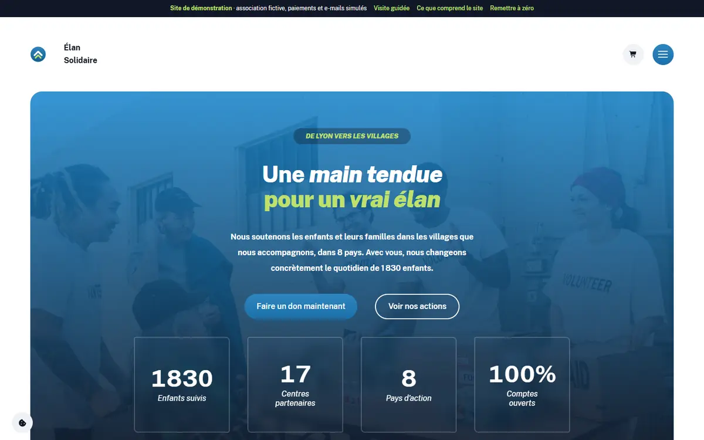</a>
</p>

<p align="center">
  <a href="https://elan-solidaire.djason-chery.dev" title="Open the live demo"></a>
  
  
  
  
  
  <a href="LICENSE" title="Read the license"></a>
</p>

<p align="center">
  <a href="https://elan-solidaire.djason-chery.dev" title="Open the live demo"><b>LIVE DEMO</b></a> &nbsp;&nbsp;·&nbsp;&nbsp;
  <a href="#what-the-demo-shows" title="Go to the features"><b>FEATURES</b></a> &nbsp;&nbsp;·&nbsp;&nbsp;
  <a href="docs/en/architecture.md" title="Read the documentation in English"><b>DOCUMENTATION</b></a> &nbsp;&nbsp;·&nbsp;&nbsp;
  <a href="README.fr.md" title="Lire cette page en français"><b>FRANÇAIS</b></a>
</p>

# Élan Solidaire

**English** · [Français](README.fr.md "Lire cette page en français")

Demo website of **Élan Solidaire**, a **fictional** humanitarian association based in Lyon (France): home page with an
interactive map, one-off or monthly donations, memberships, a charity shop with a cart, events with online sign-up, a
contact form, a member space and a full administration.

It is a portfolio project by [Djason CHERY](https://djason-chery.dev "Djason CHERY's website"): the rebuild, in Next.js
and React, of a real site made earlier, with every trace of the real client replaced by invented content. **Nothing
here is real**: the association, the people, the addresses, the products and the bank details are invented; payments
and e-mails are simulated. The site is in French.

**Live demo: [elan-solidaire.djason-chery.dev](https://elan-solidaire.djason-chery.dev "Open the live demo")**

## What the demo shows

| Area | Features |
| --- | --- |
| Home | Hero with key figures, current fundraiser, mission, carousels, map of the field actions (Leaflet, loaded only after consent), programs, newsletter, photo gallery, questions |
| Support | Donation to a project (suggested or free amount), one-off or monthly, cost after the 66 % tax reduction shown live, membership plans, payment by card or PayPal (simulated) or bank transfer |
| Fundraiser | Progress bar of a current fundraiser (home, donation page, dashboard), updated by every demo donation |
| Tax receipt | Fictional tax receipt as a PDF generated in the browser, also in the member space |
| Shop | Catalog with search, categories, sort and pages, product pages with sizes and stock per size, cart, shipping by chargeable weight, checkout |
| Orders | Paid at once, then "En préparation", "Expédiée" (fictional tracking number, `/suivi/` page) and "Livrée", one minute apart on the demo; a toast at each step; the admin can cancel or refund |
| Events | Events (`/evenements/`) as cards with a date block and a status (seats available, last seats, full, past), past events apart; online sign-up, shown in the member space, managed in the admin |
| Accounts | Login, one-click demo accounts, forgotten password with a one-hour single-use link, member space (membership, donations, orders, sign-ups) |
| Administration | Dashboard (donations by month, fundraiser goal, memberships ending within 30 days, to-do), events, donations (CSV export, receipts), members, orders, messages, products / map places / photos editors (images compressed to WebP in the browser), newsletter, settings |
| What this site includes | Page `/fonctionnalites/` (demo banner): every feature by area, what is simulated and what would become real |
| Demo tools | "Site de démonstration" banner with a guided tour (6 steps, keyboard, down to 320 px), "Ce que comprend le site" and "Remettre à zéro" (reset) with confirmation |

<table>
  <tr>
    <th width="50%">Donation</th>
    <th width="50%">Membership</th>
  </tr>
  <tr>
    <td width="50%">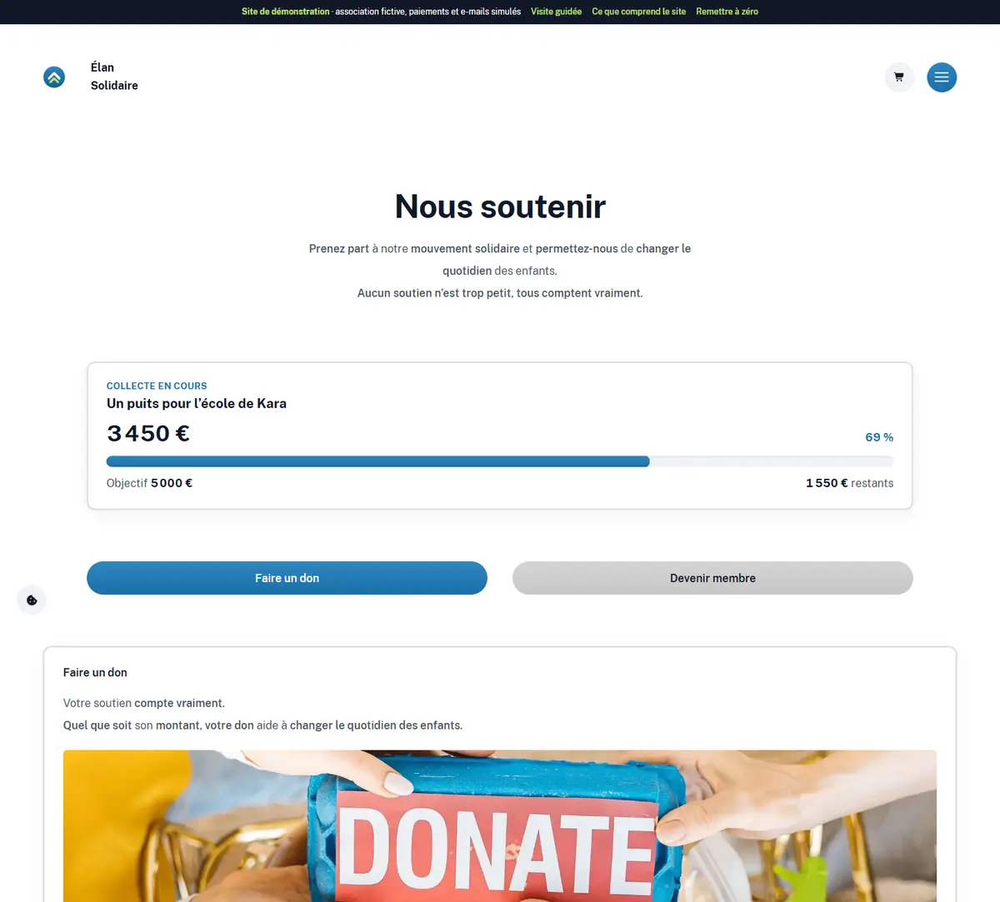</td>
    <td width="50%">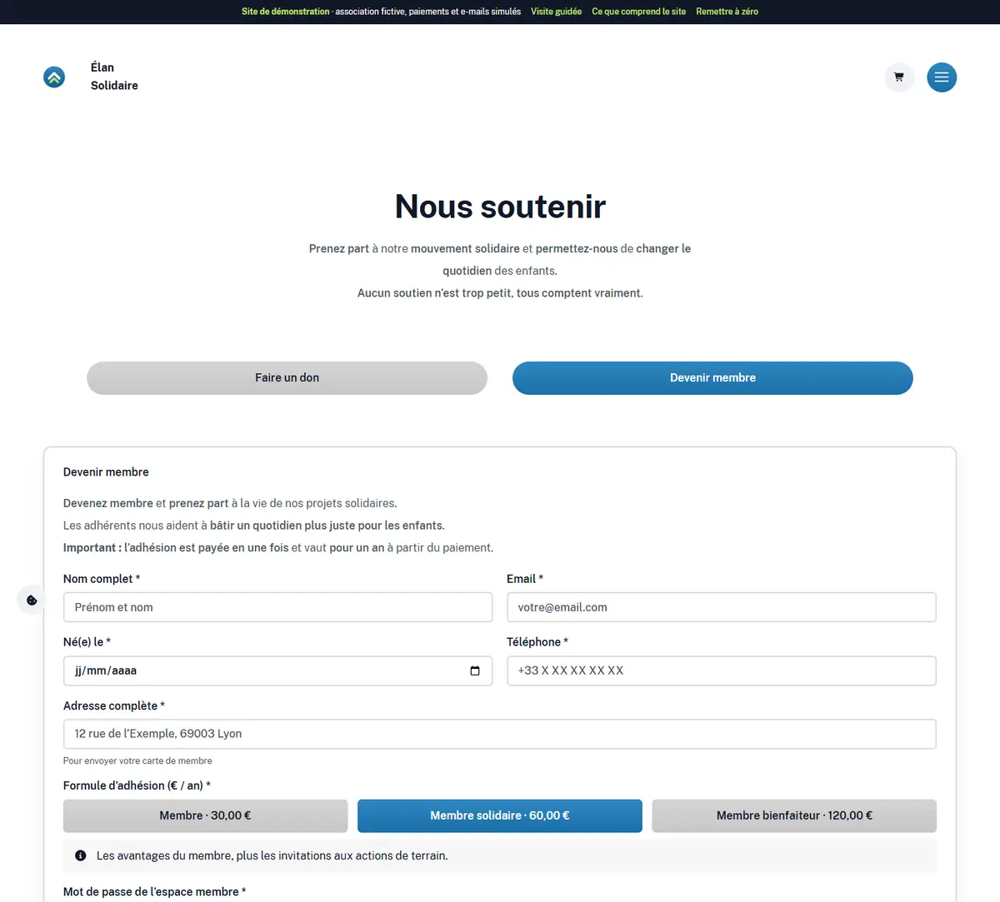</td>
  </tr>
  <tr>
    <th width="50%">Shop</th>
    <th width="50%">Product page</th>
  </tr>
  <tr>
    <td width="50%">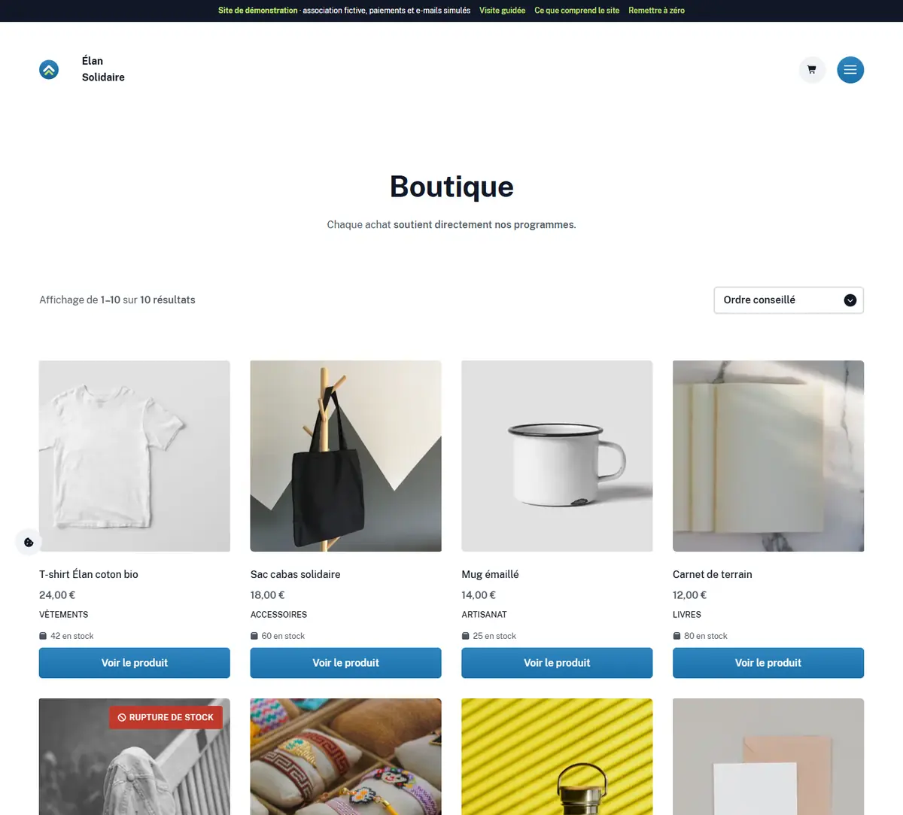</td>
    <td width="50%">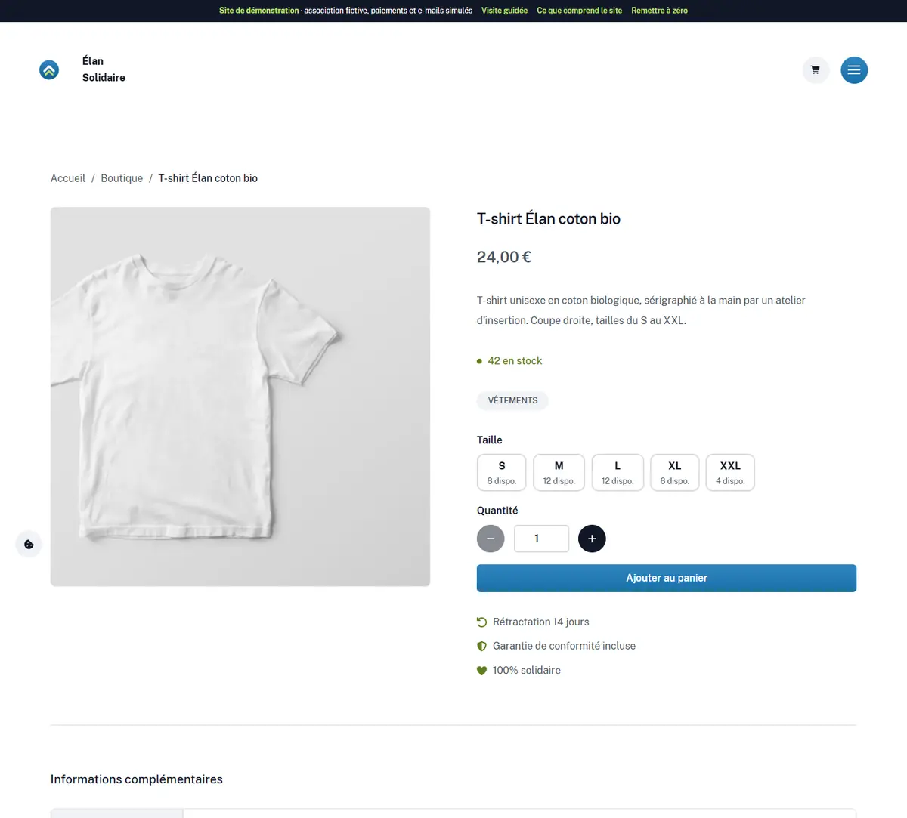</td>
  </tr>
  <tr>
    <th width="50%">Events</th>
    <th width="50%">Member space</th>
  </tr>
  <tr>
    <td width="50%">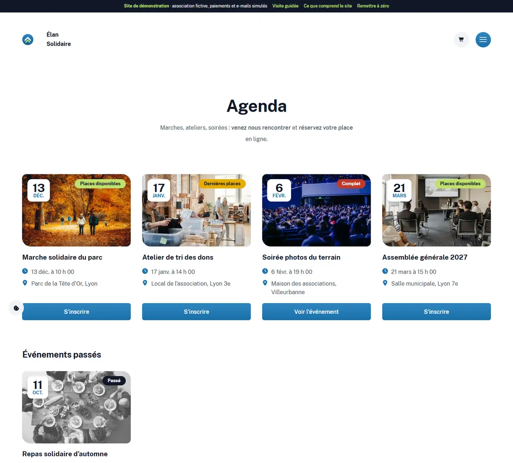</td>
    <td width="50%">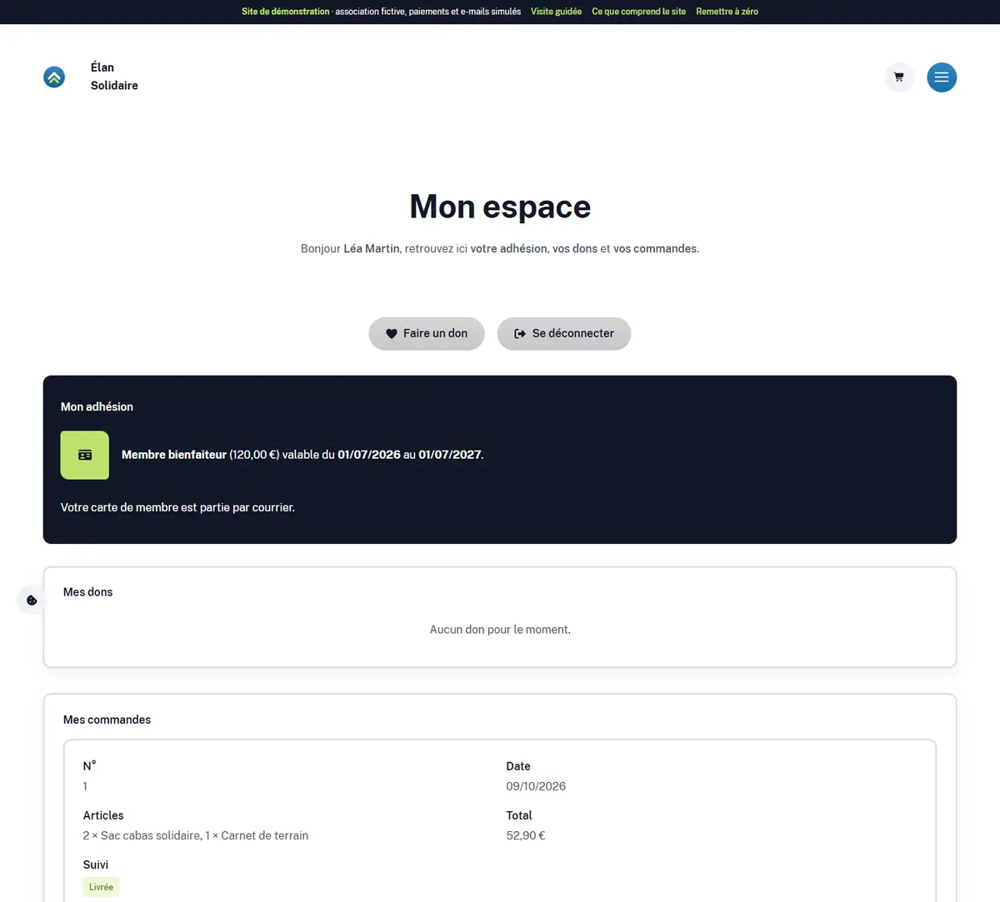</td>
  </tr>
  <tr>
    <th width="50%">Administration</th>
    <th width="50%">What this site includes</th>
  </tr>
  <tr>
    <td width="50%">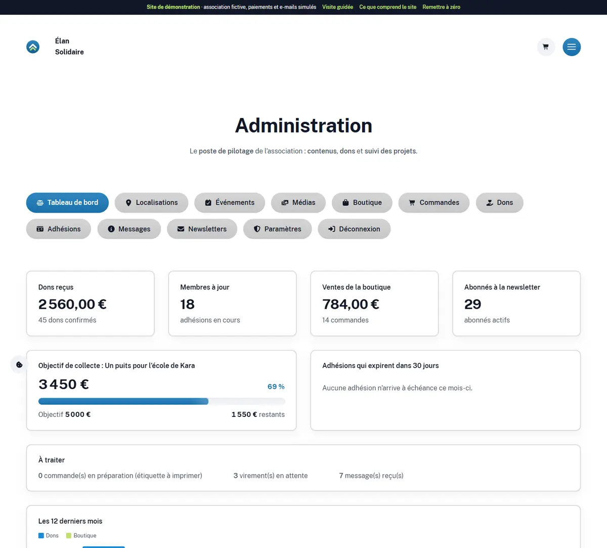</td>
    <td width="50%">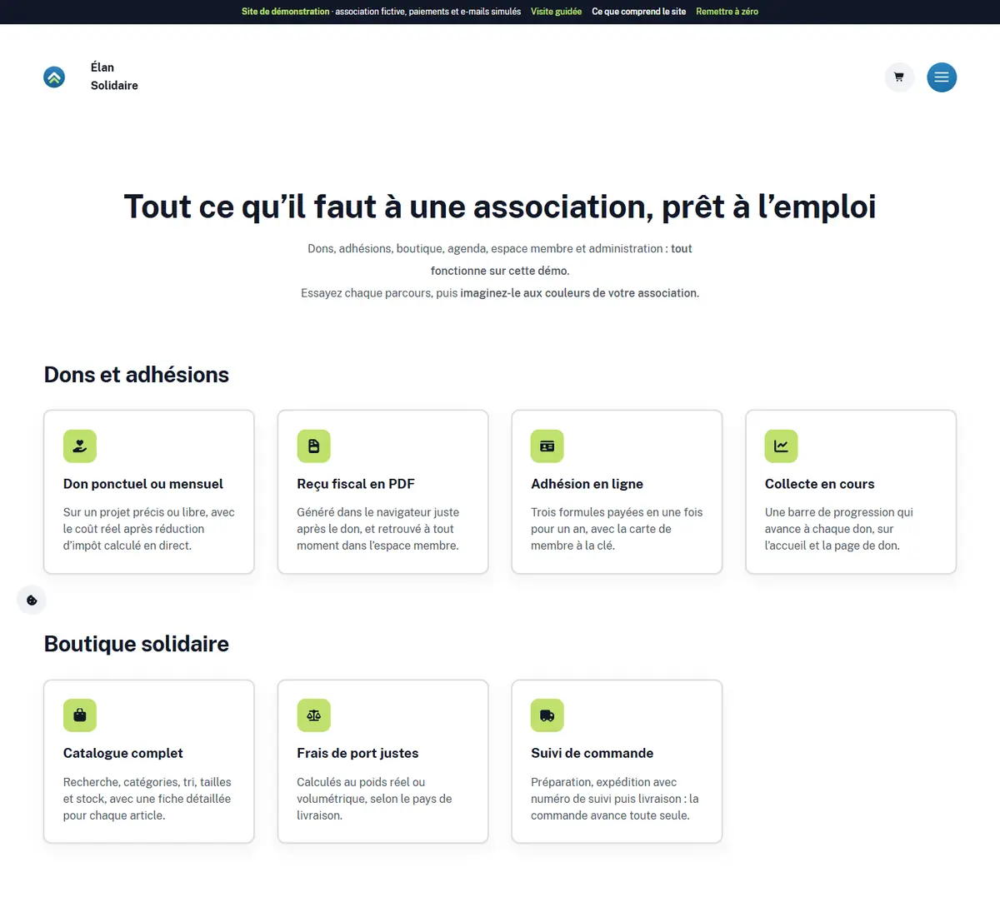</td>
  </tr>
</table>

<table>
  <tr>
    <th width="50%">Phone</th>
    <th width="50%">Menu</th>
  </tr>
  <tr>
    <td width="50%" align="center">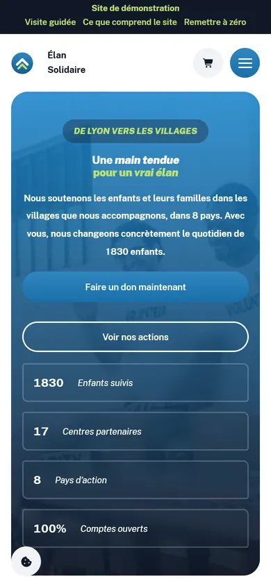</td>
    <td width="50%" align="center">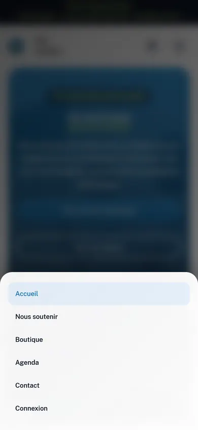</td>
  </tr>
</table>

### What is simulated

There is no server and no database. `utils/api.ts` keeps the interface of a REST API client and `utils/demo/` answers
every request in the browser, with the same routes, HTTP codes and JSON as a real API (validation, access control,
simulated delay). What the visitor does stays in `localStorage` (key `elan-solidaire-demo`), read back and checked at
each visit. Passwords are stored as salted SHA-256 hashes. E-mails are never sent: a preview is shown. "Remettre à
zéro", in the banner, brings back the starting data. Details and how to plug a real API:
[docs/en/demo-api.md](docs/en/demo-api.md "Demo API").

### Demo accounts

Also as buttons on the login page.

| Role | E-mail | Password |
| --- | --- | --- |
| Admin | `admin@elan-solidaire.example` | `Demo-Admin-2026` |
| Member | `membre@elan-solidaire.example` | `Demo-Membre-2026` |

Test cards of the simulated payment: `4242 4242 4242 4242` is accepted, `4000 0000 0000 0002` is declined.
No Stripe or PayPal script is loaded and no card number leaves the payment window.

## Stack

- [Next.js 16](https://nextjs.org "Next.js") (Pages Router) and React 19, strict **TypeScript**, exported as a
  **static site** (`output: 'export'`): no server, no database
- [Zustand](https://zustand.docs.pmnd.rs "Zustand") for the stores (session, cart, admin cache, windows, guided tour,
  fundraiser) and their actions in `stores/actions/`
- [Leaflet](https://leafletjs.com "Leaflet") for the map, downloaded only when the visitor accepts it
- Plain CSS with the variables of the original design (blue, lime green, dark navy), self-hosted Public Sans font,
  inline SVG icons
- Structure of **[DC Scaffold](https://tools.djason-chery.dev/en/scaffold/ "Discover DC Scaffold")**, the author's project
  generator (one file per page, views in `components/views/`, stores and their actions, same JSON format as the
  generated APIs)

## Run it

Node.js 20 or newer is needed.

```bash
cd frontend
npm install
npm run dev        # http://localhost:3000
```

On Windows, `start.bat` then `D` does the same (and installs what is missing). macOS and Linux: `./start.sh`.

Settings are in `frontend/.env` (development) and `frontend/.env.production` (build): copy `frontend/.env.example`.
They only hold the name and address of the site; no secret is needed.

## Scripts and checks

Run in `frontend/`. All of them must end with no error and no warning.

| Command | Role |
| --- | --- |
| `npm run dev` | Development site on http://localhost:3000 |
| `npm run typecheck` | TypeScript (`tsc --noEmit`, strict mode): zero errors |
| `npm run lint` | ESLint: zero errors, zero warnings |
| `npm run build` | Static site in `frontend/out/`, then `sitemap.xml`, `robots.txt` and the CSP hashes in `_headers` (`scripts/sitemap.mjs`, `scripts/csp.mjs`) |
| `npm run test:ui` | Interface checks with Playwright on the built site served locally, at 320, 375, 768, 1024 and 1440 px (see below) |

`npm run test:ui` checks the hover state of every interactive element, the gap between the blocks of every form
(`--form-gap`, 1 px at most), card padding, the alignment of check boxes and radio buttons, `aria-current="page"` on
every navigation link to the current page, and feedback (errors and successes as toasts, never under the fields).
Example: `BASE=http://localhost:3100 npm run test:ui`.

## Folders

```text
frontend/
├── pages/                 one file per page: sets its SEO and shows its view
├── components/
│   ├── layout/            AppShell (loader, header, footer, windows), Header, Footer
│   ├── ui/                reusable blocks: BaseButton, CircleButton, FormField, Modal, DataList, Icon, SiteImage...
│   └── views/             the content of each page (Home, Support, Shop, Product, Cart, Events, Admin...)
├── composables/           hooks: useForm, useApiData, usePayment, useReveal...
├── middleware/            guards.ts: private pages (/admin, /espace-membre)
├── stores/                Zustand stores (auth, cart, support, admin, ui, notifications, demo, tour, fundraiser, userPreferences); their actions in stores/actions/
├── utils/
│   ├── api.ts             API client: get, post, put, delete, download
│   ├── demo/              the demo API: router, handlers, starting data (seed/), localStorage storage
│   ├── content/           texts and data of the fictional association
│   ├── types.ts           shared types (Product, CartItem, Order, Donation, Membership, Event, Place, Toast...)
│   ├── validation.ts      rules of every form, used by the forms and by the demo API
│   ├── shipping.ts        shipping by chargeable weight
│   └── seo.ts             title, description, Open Graph and JSON-LD of every page
├── assets/css/            main.css imports: utils/ (fonts, variables), base/, components/ (one file per shared component), views/
├── scripts/               sitemap.mjs, csp.mjs (after the build)
├── tests/                 ui-checks.mjs and its probes: automatic interface checks (npm run test:ui)
└── public/                fonts, photos (WebP), logo, favicons, _headers, _redirects, .htaccess
scripts/                   helpers of start.bat / start.sh
docs/                      detailed documentation (fr, en) and screenshots
```

More details: [docs/en/architecture.md](docs/en/architecture.md "Architecture").

## Conventions

- **Strict TypeScript** everywhere (`strict`, `noUncheckedIndexedAccess`, `@/` alias), no `any` and no `@ts-ignore`
  (one commented exception: the JSON body of the demo requests, checked by `utils/validation.ts`).
- **Sizes and spacing through classes**: the `text-*` classes (`text-small`, `text-normal`, `text-large`...) set the
  size of every text, fields and placeholders included (16 px minimum on phones); spacing uses the `gap-*`, `mt-*` and
  `mb-*` classes.
- **Base components**: buttons and fields go through `BaseButton`, `CircleButton` and `FormField`, never hand-made.
- **Feedback as toasts**: errors and successes in a notification, never an error text under the fields.
- **Hover and pressed states**: mouse only, inside `@media (hover: hover) and (pointer: fine)`.
- **Links**: the link to the current page has `aria-current="page"`; never a link inside brackets.
- **One light loader** (the four blue bars of the design), at opening and on every page change, never blocking clicks.
- **Accessibility**: down to 320 px wide and tall, tables turned into cards on phones, keyboard everywhere, visible
  focus, labelled fields, AA contrast, every link has a `title`, every image an `alt` and a `title`.

## Technical choices

- **A demo API instead of a server**: replacing `utils/demo/` with a real API is enough, views and stores stay the same.
- **Static pages with their real content**: public pages are built with the starting data (`getStaticProps`), so their
  HTML is complete for search engines, then updated with the data of the visitor's browser.
- **Front-end security**: no HTML injection (no `dangerouslySetInnerHTML` on data, map popups built with
  `textContent`), data read back from `localStorage` is checked, demo passwords are hashed, payment and reset tokens
  are random, the same validation rules in the forms and in the demo API, prices always recomputed from the catalog,
  CSV export protected against formula injection, external links with `rel="noopener noreferrer"`, strict CSP.
- **Speed**: fonts and first-screen images preloaded, map and its library loaded only after consent, SVG icons (no icon
  font), WebP photos in five widths (320 to 1920 px) served with `srcset` and `sizes` by a custom image loader
  (`utils/imageLoader.ts`).

### Products and shipping

Every product has a **weight in grams**, **dimensions** length × width × height in cm and, for clothes, **sizes**
(S, M, L, XL...) with their own stock; other products are one size. The admin form asks for them with their unit and
checks them (weight from 1 to 30,000 g, each side from 0.1 to 200 cm, sizes written `S:8, M:12`), the product page shows
them with a size choice, and the cart keeps one line per product **and** per size.

Shipping is computed on the **chargeable weight** of the parcel: the larger of

- the **actual weight**: sum of the item weights;
- the **volumetric weight**: sum of the volumes (L × W × H in cm³) divided by **5,000**, the usual carrier divisor
  (a light but bulky parcel costs like a heavier one).

The chargeable weight falls into a **weight band**, and each zone has a price per band (`utils/shipping.ts`):

| Chargeable weight | France | Near Europe (BE, LU, DE, ES, IT) | Switzerland, Canada |
| --- | --- | --- | --- |
| up to 0.5 kg | €4.90 | €9.90 | €14.90 |
| up to 1 kg | €6.90 | €12.90 | €19.90 |
| up to 2 kg | €8.50 | €15.90 | €26.90 |
| up to 5 kg | €12.90 | €22.90 | €39.90 |
| over 5 kg | €19.90 | €32.90 | €59.90 |

Shipping is free in France from €60 of items. The same computation runs in the cart and in the demo API, which
recomputes prices from the catalog and checks the stock of each size.

### Page addresses

Every visible address is in French with readable slugs (the code stays in English). The old English addresses
redirect to the new ones with a 301 through `frontend/public/_redirects` (Cloudflare Pages).

| Page | Address |
| --- | --- |
| Home (mission, map, actions, photos, questions as sections) | `/` |
| Donation / membership | `/don/`, `/adhesion/` |
| Bank transfer details | `/virement/` |
| Shop / product | `/boutique/`, `/boutique/produit/<slug>/` (product added in the admin: `/boutique/produit/apercu/?produit=<slug>`) |
| Cart and checkout | `/panier/` |
| Parcel tracking | `/suivi/?colis=<number>` |
| Contact | `/contact/` |
| Login / forgotten password | `/connexion/`, `/mot-de-passe-oublie/` |
| Events / event | `/evenements/`, `/evenements/<slug>/` |
| What this site includes | `/fonctionnalites/` |
| Member space | `/espace-membre/` |
| Administration | `/admin/`, `/admin/produits/`, `/admin/lieux/`, `/admin/evenements/`, `/admin/medias/`, `/admin/commandes/`, `/admin/dons/`, `/admin/adhesions/`, `/admin/messages/`, `/admin/newsletters/`, `/admin/reglages/` |
| Legal pages | `/mentions-legales/`, `/confidentialite/`, `/cookies/`, `/cgv/` |

Slugs come from `frontend/utils/slugify.ts` (lowercase, no accents, dashes); a product created in the admin gets a
unique slug (`uniqueSlug`) that does not change when it is renamed. `/admin` and `/espace-membre` are `noindex` and
left out of `sitemap.xml` and `robots.txt`.

## Deploy

The demo is live on **Cloudflare Pages**, project `elan-solidaire`, at
**[elan-solidaire.djason-chery.dev](https://elan-solidaire.djason-chery.dev "Open the live demo")** (a CNAME record at
Infomaniak points to `elan-solidaire.pages.dev`). One-command deploy:

```bash
cd frontend && npm run build && npx wrangler pages deploy out --project-name elan-solidaire --branch master
```

For another Cloudflare Pages project linked to a Git repository, the settings are:

| Setting | Value |
| --- | --- |
| Root directory | `frontend` |
| Build command | `npm run build` |
| Build output directory | `out` |
| Environment variables | `NEXT_PUBLIC_SITE_NAME=Élan Solidaire`, `NEXT_PUBLIC_SITE_URL=https://<your-project>.pages.dev` |

`frontend/public/_headers` sets the security headers (strict Content Security Policy, `X-Content-Type-Options`,
`Referrer-Policy`, `Permissions-Policy`, `frame-ancestors`) and the cache rules on Cloudflare.
`frontend/public/.htaccess` does the same on an Apache host. Full steps:
[docs/en/deployment.md](docs/en/deployment.md "Deployment").

## Documentation

| Topic | English | Français |
| --- | --- | --- |
| Architecture | [architecture.md](docs/en/architecture.md "Architecture") | [architecture.md](docs/fr/architecture.md "Architecture (français)") |
| Demo API | [demo-api.md](docs/en/demo-api.md "Demo API") | [api-de-demo.md](docs/fr/api-de-demo.md "API de démo (français)") |
| Deployment | [deployment.md](docs/en/deployment.md "Deployment") | [mise-en-ligne.md](docs/fr/mise-en-ligne.md "Mise en ligne (français)") |
| Credits | [credits.md](docs/en/credits.md "Credits") | [credits.md](docs/fr/credits.md "Crédits (français)") |

## License

Code shown for demonstration, **all rights reserved**: no reuse without written permission, see [LICENSE](LICENSE "License") (licence on request: [djason-chery.dev](https://djason-chery.dev "Djason CHERY's website")). The Public Sans font is under the SIL Open Font License 1.1, the icons come from Font Awesome Free (CC BY 4.0), the photos from Pexels (Pexels license, see the [credits](docs/en/credits.md "Credits")).

## Credits

- Photos: 33 free photos from [Pexels](https://www.pexels.com "Pexels") (Pexels license, 25 photographers), resized and
  converted to WebP; the full list is in the legal notice of the site and in
  [docs/en/credits.md](docs/en/credits.md "Credits").
- Font: **Public Sans** (U.S. Web Design System), under the SIL Open Font License 1.1
  (`frontend/public/fonts/PublicSans/OFL.txt`).
- Icons: **Font Awesome Free** (CC BY 4.0), paths copied into `frontend/utils/icons.ts`.
- Map: **Leaflet** (BSD-2-Clause) and tiles by the **OpenStreetMap** contributors (ODbL).
- Logo, favicons and share image: made for this demo.
- Design and development: [Djason CHERY](https://djason-chery.dev "Djason CHERY's website"), with
  [DC Scaffold](https://tools.djason-chery.dev/en/scaffold/ "Discover DC Scaffold").
